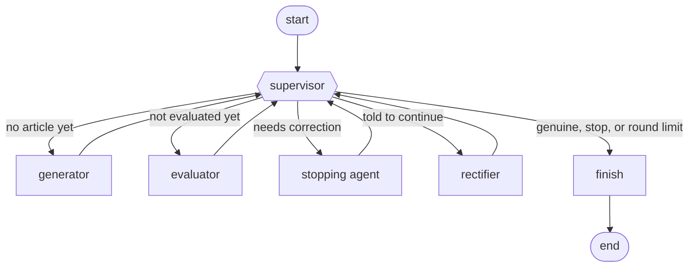
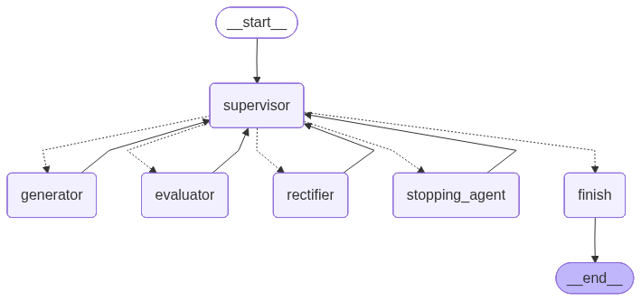
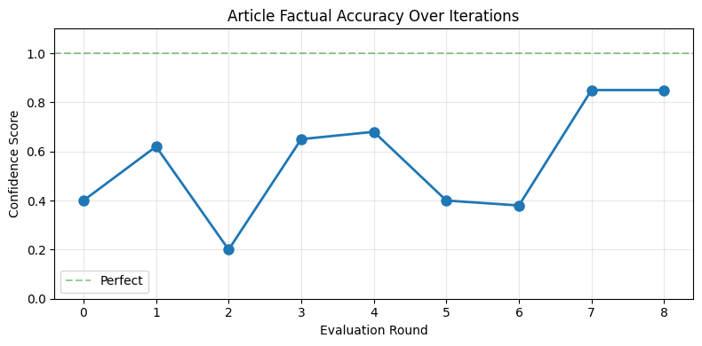

# News Verification Agents

A multi-agent loop, built on [LangGraph](https://github.com/langchain-ai/langgraph), that fact-checks a short news article against web search and rewrites it until a second model accepts it.

One model writes, a different model judges. A supervisor routes between four agents (generator, evaluator, stopping agent, rectifier) and a hard cap on rounds keeps the loop bounded.

## How it works



| Agent | Model (via Groq) | Job |
| --- | --- | --- |
| Supervisor | none | Picks the next agent from the state. Plain Python, no model call: the order of steps is fixed, so there is nothing for a model to decide. |
| Generator | `llama-3.3-70b-versatile` | Writes a short, realistic-looking draft that may contain fabricated details. It exists to give the loop something to catch. Skipped if you supply your own article. |
| Evaluator | `openai/gpt-oss-120b` | Searches the web for the article, then returns a verdict (`genuine` / `needs_correction`), written feedback and a factual-accuracy score from 0 to 1. |
| Stopping agent | `openai/gpt-oss-120b` | Reads the feedback and score and decides whether another round is worth it. |
| Rectifier | `llama-3.3-70b-versatile` | Pulls results from Reuters, BBC and AP for the topic and rewrites the article to fix what the evaluator flagged. |

The writer and the judge are different models on purpose, so a model is never grading its own output.

The loop ends when the evaluator says `genuine`, the stopping agent says `stop`, or the round limit is reached (default 8). The result says which of the three happened, and `verified` is true only in the first case.

The compiled graph, as LangGraph draws it:



## A recorded run

Topic: `FIFA`. Recorded from the prototype notebook ([`notebooks/prototype.ipynb`](notebooks/prototype.ipynb)), before the round limit existed. Full output: [`examples/fifa_run_log.txt`](examples/fifa_run_log.txt).



| Round | Score | Verdict | What happened |
| --- | --- | --- | --- |
| 0 | 0.40 | needs correction | Only a headline was kept as the article (see below). It claimed a formal FIFA–UN partnership; the evidence only showed FIFA taking part in a UN climate initiative. |
| 1 | 0.62 | needs correction | Headline only again, so the evaluator mostly critiqued the search snippets. |
| 2 | 0.20 | needs correction | Same problem; the evaluator found no support for the claims it was reading. |
| 3 | 0.65 | needs correction | First full article. Evaluator flagged "104 matches" as wrong. |
| 4 | 0.68 | needs correction | Flagged an unsupported claim that players get a formal governance role. |
| 5 | 0.40 | needs correction | The rewrite added new claims, which the evaluator could not find support for. |
| 6 | 0.38 | needs correction | Governance claim and "104 matches" flagged again. |
| 7 | 0.85 | needs correction | One unsupported clause left. |
| 8 | 0.85 | genuine | Accepted after that clause was removed. |

## What the run showed

The loop reached `genuine`, but reading the log is more useful than the final verdict.

- **The score does not rise steadily.** It fell from 0.68 to 0.40 in round 5 because the rewrite introduced new claims. A rectifier fixes what it is told to fix and can break something else.
- **The evaluator overruled a correct fact.** The 2026 World Cup has 48 teams and 104 matches. The evaluator twice insisted on 80 (an earlier proposed format), and the rectifier changed the article to match. The judge trusted its own stale knowledge over the article.
- **It converged by deleting, not by verifying.** The accepted article is the one with the specific claims stripped out. "Genuine" here means "the evaluator found nothing left to object to".
- **A parsing problem cost three rounds.** In rounds 0 to 2 the pipeline kept only a one-line headline as the article, most likely because the model wrote the body first and put just the headline after the output marker. The package now asks for the article after the marker and keeps the body if a model does it anyway (`extract_article` in [`news_verifier/parsing.py`](news_verifier/parsing.py), covered by a test).
- **The evidence is thin.** The evaluator sees a handful of search snippets found by searching on the first 300 characters of the article. Its verdict is one model's judgement on that evidence, not ground truth.

## Setup

Needs Python 3.10 or newer and a free [Groq API key](https://console.groq.com/keys).

```bash
python -m venv venv

# Windows
venv\Scripts\activate
# macOS / Linux
source venv/bin/activate

pip install -r requirements.txt
```

Copy `.env.example` to `.env` and put your key in it:

```
GROQ_API_KEY=your_groq_api_key_here
```

## Usage

Generate a draft on a topic and run it through the loop:

```bash
python main.py "FIFA"
```

Check and correct your own article instead:

```bash
python main.py "FIFA" --article-file my_article.txt
```

Options:

| Flag | Effect |
| --- | --- |
| `--max-iterations N` | Limit on rectification rounds (default 8) |
| `--plot outputs/scores.png` | Save the score-per-round chart |
| `--json outputs/result.json` | Save the final article, verdict, scores and stop reason |
| `--quiet` | Print only the final result |

From Python:

```python
from dotenv import load_dotenv
from news_verifier import run

load_dotenv()
result = run("FIFA")

print(result["final_article"])
print(result["verified"], result["confidence_history"], result["stop_reason"])
```

With the default limit of 8, one run makes at most 9 calls to the writer model, 17 to the judge model and 17 web searches. The models and limits can be changed in `.env` (see `.env.example`).

## Tests

```bash
pip install -r requirements-dev.txt
pytest
```

The tests replace the models and the web search with scripted stand-ins, so they run offline in under a second and need no API key. They cover the reply parsers, every supervisor routing branch, and whole-graph runs: accepted first time, corrected then accepted, stopped by the stopping agent, stopped by the round limit, a supplied article, and a failed search.

## Project layout

```
news_verifier/
    config.py      settings and environment overrides
    state.py       the shared graph state
    prompts.py     prompt templates for each agent
    parsing.py     turns model replies into verdicts, scores and articles
    search.py      web search wrapper
    nodes.py       the agents and the supervisor's routing rule
    graph.py       graph assembly and the run() helper
    plotting.py    score-per-round chart
main.py            command-line entry point
tests/             offline tests
notebooks/         the original prototype notebook
examples/          output of the recorded run
```

## Next steps

- Give the evaluator today's date and tell it to prefer the web evidence over its own memory when they disagree (the "104 matches" failure).
- Check claim by claim: extract the individual claims, search for each one, and score them separately instead of searching on the article's opening lines.
- Return the best-scoring draft when the loop ends without a `genuine` verdict, not the last one.
- Use structured output for verdicts instead of parsing free text.
- Build a small labelled set of true and false articles to measure how often the evaluator is right.

## License

MIT. See [`LICENSE`](LICENSE).
